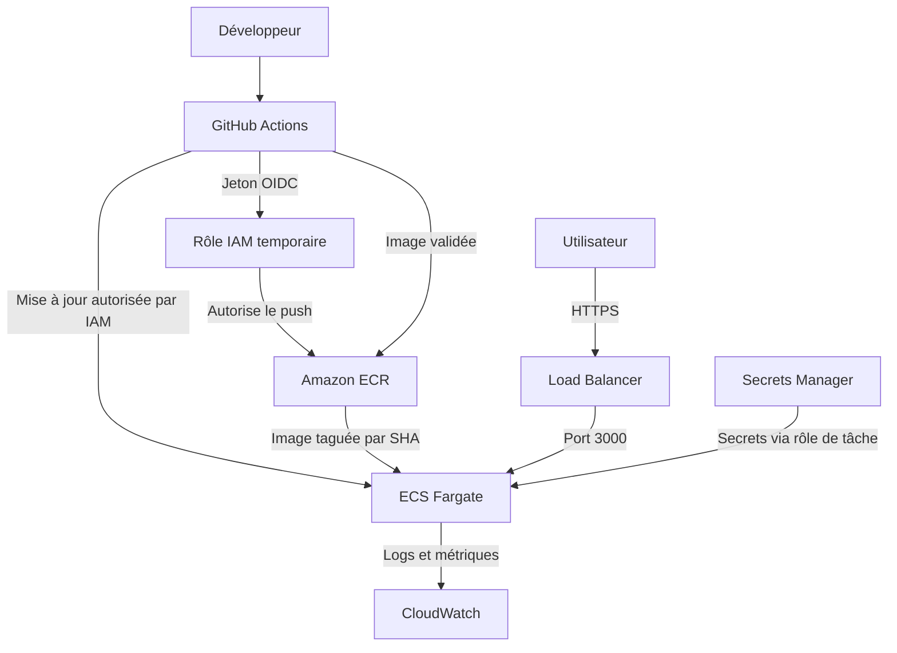

# TP3 — DevSecOps

[](https://github.com/AYZERTY/devsecops-tp/actions/workflows/ci.yml)
[](https://github.com/AYZERTY/devsecops-tp/actions/workflows/codeql.yml)

Le but du TP est de sécuriser une API Express, contrôler les dépendances et l'image Docker, puis chiffrer une architecture AWS. Aucune ressource AWS n'a été créée.

## Lancer le projet

Avec Node.js 22 :

```bash
npm ci
npm test
npm run audit
npm start
```

L'API écoute sur le port 3000. Pour changer le port : `PORT=4000 npm start`. `.env.example` documente cette variable ; le fichier `.env` n'est pas chargé automatiquement.

| Route | Utilisation |
| --- | --- |
| `/health` | État de l'application |
| `/hello?name=Lina` | Message de bienvenue avec échappement HTML |
| `/ping?host=example.com` | Un ping, sans shell, avec délai maximum de 3 secondes |
| `/prefs?theme=dark&lang=en` | Thème `light` ou `dark`, langue `fr` ou `en` |

Le programme `ping` doit être installé si l'application est lancée hors Docker. Il est disponible dans l'image Alpine. Les tests simulent ce programme : ils n'envoient aucun paquet sur le réseau.

## Sécurité & coûts

### 1. Secrets

`.gitignore` exclut `node_modules/`, `.env`, `coverage/` et les logs. `.env.example` contient seulement `PORT=3000`. Aucun identifiant AWS n'est nécessaire pour ce TP.

**Clé AWS publiée puis supprimée :** supprimer la clé du dernier fichier ne suffit pas. Elle reste dans l'historique Git, les clones ou des copies. Il faut :

1. Désactiver immédiatement la clé compromise, puis la supprimer. Prévenir le responsable de sécurité.
2. Examiner CloudTrail, les accès et la facturation pour repérer un usage anormal ; traiter les autres accès éventuellement compromis.
3. Si un accès reste nécessaire, utiliser un rôle temporaire OIDC, ou remplacer la clé et mettre à jour ses consommateurs.
4. Nettoyer l'historique et les copies contrôlables, en coordination avec l'équipe. Cela ne remplace jamais la révocation.
5. Activer la détection des secrets et la protection au push pour éviter une nouvelle fuite.

Les réglages GitHub qui nécessitent une session administrateur et leur capture sont suivis dans [docs/reglages-github.md](docs/reglages-github.md). Leur activation n'est pas déduite de la seule présence des fichiers YAML.

### 2. Dépendances

Mesures du 4 novembre 2026, avec `npm audit --json`, dépendances de développement incluses :

| État | Critical | High | Moderate | Low |
| --- | ---: | ---: | ---: | ---: |
| Avant | 0 | 5 | 16 | 7 |
| Après | 0 | 0 | 16 | 4 |

Express passe de `4.17.1` à `4.22.3` et Lodash de `4.17.15` à `4.18.1`. Lodash sert uniquement à échapper le HTML ; la fusion récursive des préférences a été supprimée. Les dépendances sont verrouillées dans `package-lock.json`.

Les alertes restantes sont basses ou modérées, principalement dans la chaîne de tests Jest. Elles restent visibles : le seuil demandé est `high`, et non « aucune vulnérabilité ». Les dépendances de test sont absentes de l'image finale.

- [Audit avant](reports/npm-audit-before.json) et [audit après](reports/npm-audit-after.json).
- [CI initial : test vert, deps-audit rouge](https://github.com/AYZERTY/devsecops-tp/actions/runs/41841573184).
- `.github/dependabot.yml` vérifie chaque semaine npm, GitHub Actions et Docker.

### 3. Les trois failles

URLs à utiliser uniquement contre sa propre instance locale de TP :

| Route | Faille / risque | URL d'attaque | Correction |
| --- | --- | --- | --- |
| `/hello` | XSS réfléchie : le navigateur peut exécuter le HTML fourni dans le nom | `http://localhost:3000/hello?name=%3Cscript%3Ealert(1)%3C%2Fscript%3E` | `lodash/escape` encode les caractères HTML ; nom limité à une chaîne de 100 caractères |
| `/ping` | Injection de commandes : le shell peut interpréter le `;` et lire un fichier du serveur | `http://localhost:3000/ping?host=google.com%3Bcat%20%2Fetc%2Fpasswd` | Validation du nom d'hôte/IPv4, `execFile` avec arguments séparés, sans shell, délai et sortie limités |
| `/prefs` | Fusion non contrôlée : risque de pollution du prototype et ajout de propriétés non prévues | `http://localhost:3000/prefs?__proto__%5Badmin%5D=true` ; variante `http://localhost:3000/prefs?constructor%5Bprototype%5D%5Badmin%5D=true` | Suppression de `merge`, parseur simple, seules les clés `theme` et `lang` et leurs valeurs prévues sont acceptées |

**Précision sur `/prefs` :** selon les versions de `qs` et Lodash, la clé `__proto__` peut déjà être ignorée avant ou pendant la fusion. On ne peut donc pas affirmer que cette URL modifie forcément `Object.prototype` dans toutes les installations. Le défaut certain du code initial est de fusionner des propriétés arbitraires. La correction refuse explicitement les clés de prototype et les clés inconnues, sans dépendre de ces filtres internes.

Les trois tests de `tests/security.test.js` échouent sur le code initial et passent après correction. Le test des préférences vérifie le refus HTTP 400 et l'absence de pollution, sans prétendre prouver une pollution réussie avant correction. Le module de processus est simulé même sur l'ancien code.

- [Échec des 3 tests sur l'ancien code](reports/regression-before.txt).
- 35 tests passent après correction : les 2 tests fournis, 3 régressions de sécurité et 30 cas de validation/comportement.
- Code initial conservé dans le commit [`dd462b6`](https://github.com/AYZERTY/devsecops-tp/commit/dd462b6d283cd70f0a5e5bb937f3c8fb065468e3).
- Corrections préparées dans la branche `fix/security`, avec une pull request vers `main`.

#### Relevé CodeQL

CodeQL est configuré par le workflow `codeql.yml` (configuration avancée versionnée). Il n'est pas nécessaire d'activer en parallèle le mode Default, qui ferait doublon. L'analyse utilise `security-extended` et bloque si une alerte de sécurité subsiste.

Le relevé exact des règles, lignes et gravités est ajouté après la comparaison automatisée des deux versions.

### 4. Pipeline durci

La CI se déclenche sur les push vers `main` et les pull requests visant `main`. Elle est aussi réutilisable par le workflow de déploiement.

- Permissions `contents: read` par défaut et délais sur chaque job.
- Installation reproductible par `npm ci`, cache npm et annulation des anciennes exécutions de la même branche.
- Jobs `test` et `deps-audit`, puis `image` uniquement si les deux réussissent.
- CodeQL écrit les résultats de scan avec `security-events: write` sur son job uniquement.
- Trivy est épinglé au commit vérifié `ed142fd0673e97e23eac54620cfb913e5ce36c25` (`v0.36.0`), avec le binaire `v0.74.0`.

**Incident Trivy de mars 2026 :** un workflow utilisant `@v0.34.0` et exécuté pendant la période de compromission pouvait récupérer le code malveillant, car le tag avait été déplacé. Un workflow épinglé au SHA d'un commit sain ne suivait pas ce déplacement. Un SHA ne garantit cependant pas à lui seul que le code est sûr : il faut vérifier le commit et les téléchargements ou actions qu'il appelle. [Avis de sécurité officiel](https://github.com/aquasecurity/trivy/security/advisories/GHSA-69fq-xp46-6x23).

La protection attendue pour `main` impose une PR et la réussite de `test`, `deps-audit` et `CodeQL` ; `image` est également conseillé. Voir le suivi des réglages administrateur.

### 5. Image Docker

Le Dockerfile utilise `node:22.23.4-alpine3.24`, deux étapes, `npm ci --omit=dev`, une copie séparée de `package*.json`, l'utilisateur `node` et le lancement direct de `src/index.js`.

```bash
docker build -t devsecops-tp:optim .
docker run --rm -p 127.0.0.1:3000:3000 devsecops-tp:optim
# Dans un autre terminal
curl http://localhost:3000/health
curl 'http://localhost:3000/ping?host=127.0.0.1'
```

Mesures sur les runners GitHub Linux amd64. Taille locale non compressée ; couches = `RootFS.Layers`. Les CVE sont comptées par occurrence dans les paquets, corrigibles ou non, avec Trivy 0.74.0.

| Image | Taille | Couches | HIGH | CRITICAL |
| --- | ---: | ---: | ---: | ---: |
| Naïve | 1 176 467 298 octets (1 122,44 Mio) | 11 | 532 | 20 |
| Optimisée | Mesure CI en cours | — | — | — |

[Mesure initiale](https://github.com/AYZERTY/devsecops-tp/actions/runs/41841572971) et [résumé](reports/image-before.json). La CI conserve les rapports d'inspection, l'historique et le scan complet en artefacts.

**Quelle couche pèse le plus ?** La couche d'installation des outils de compilation et bibliothèques Debian : environ 588 Mo. Elle vient de la base `node:22`, avant l'ajout de l'application.

**Un `.env` et `.git` seraient-ils inclus ?** Oui : avec le Dockerfile initial, `COPY . .` copie tout le contexte sans `.dockerignore`. Le `.gitignore` ne protège pas le contexte Docker. La version corrigée ignore ces fichiers et copie seulement les dépendances, `package*.json` et `src/` dans l'image finale.

Le job `image` vérifie `/health`, un ping local, l'utilisateur non-root et l'absence de `.git`, `.env` et Jest. Il collecte toutes les CVE puis échoue si une CVE HIGH ou CRITICAL a une correction disponible (`--ignore-unfixed --exit-code 1`).

### 6. Architecture AWS envisagée



Une tâche Fargate utilise 0,25 vCPU et 0,5 Go. Les prix ci-dessous sont ceux **fournis dans l'énoncé** pour l'exercice, hors ALB, stockage ECR, logs, secrets, transferts et taxes.

| Scénario | Heures / mois | Calcul | Coût / mois |
| --- | ---: | --- | ---: |
| A. x86, 24 h/24 | 730 | `(0,25 × 0,04048 + 0,5 × 0,004445) × 730` | **9,01 $** |
| B. ARM, 24 h/24 | 730 | `(0,25 × 0,03238 + 0,5 × 0,003556) × 730` | **7,21 $** |
| C. x86, 12 h/jour, 5 jours/semaine | 260 | `12 × 5 × 52 ÷ 12 = 260 h`, puis `(0,25 × 0,04048 + 0,5 × 0,004445) × 260` | **3,21 $** |

Le scénario C utilise un mois moyen de 52/12 semaines, pas 4 semaines exactes. Pour novembre 2026 précisément (21 jours du lundi au vendredi, sans déduire les jours fériés), cela ferait 252 h et **3,11 $**. ARM suppose de construire l'image pour `linux/arm64` et de configurer la tâche en `ARM64` ; changer seulement le prix ne suffit pas.

**NAT Gateway :** `0,045 × 730 = 32,85 $/mois`, même sans trafic, soit environ **3,65 fois** la tâche x86 du scénario A. Tâche + NAT = **41,86 $/mois**, avant les autres services et le traitement des données. Pour une petite API, le réseau et le Load Balancer peuvent coûter davantage que le calcul. Il faut comparer le besoin réel de NAT, les endpoints VPC et les autres architectures, en chiffrant aussi leurs coûts. Un budget avec alertes doit être prévu avant de créer la première ressource.

La politique [aws/ecr-lifecycle.json](aws/ecr-lifecycle.json) conserve les 10 images les plus récentes selon leur date de push, qu'elles soient taguées ou non. En production, il faut aussi prévoir les besoins de rollback avant d'appliquer cette rétention.

### Bonus : déploiement OIDC

`deploy-aws.yml` se déclenche sur un push vers `main`, mais ses jobs restent ignorés tant que `AWS_ENABLED` n'est pas égal à `true`. Ce TP ne l'active pas.

Le déploiement dépend des tests, de l'audit, du scan d'image et de CodeQL. Seul le job `deploy` possède `id-token: write`. Il utilise l'environnement `production`, une concurrence unique, un rôle OIDC, ECR et une image taguée avec `github.sha`, jamais `latest`. L'image reconstruite est rescannée avant le push, puis le service ECS existant est mis à jour avec une nouvelle révision de tâche.

Avant une utilisation réelle, il faudrait configurer :

- Un fournisseur OIDC GitHub et un rôle IAM de moindre privilège. La confiance doit vérifier `aud = sts.amazonaws.com` et `sub = repo:AYZERTY/devsecops-tp:environment:production`.
- L'environnement `production`, limité à `main`, et les protections de déploiement souhaitées.
- Les variables `AWS_ENABLED`, `AWS_ROLE_ARN`, `AWS_REGION`, `ECR_REPOSITORY`, `ECS_CLUSTER`, `ECS_SERVICE`, `ECS_CONTAINER_NAME`.
- Un dépôt ECR, un service ECS, les rôles d'exécution/de tâche, les logs et le réseau. Le workflow lit la tâche du service existant ; il ne crée pas cette infrastructure.

Aucune clé AWS permanente n'est enregistrée dans le dépôt ou demandée par le workflow.
